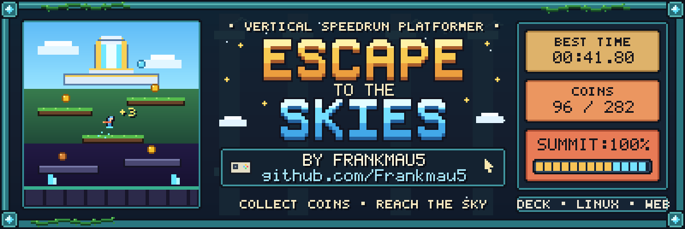
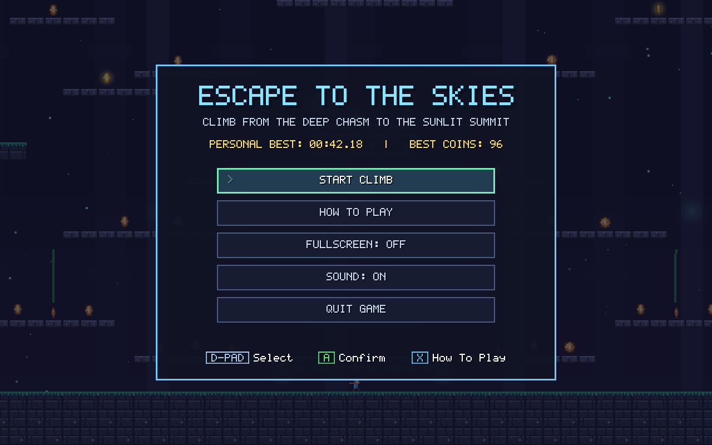
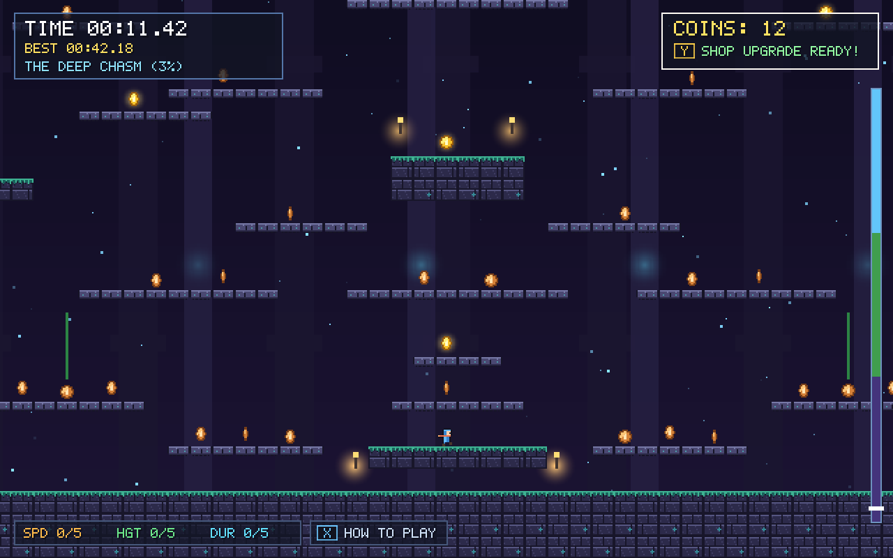
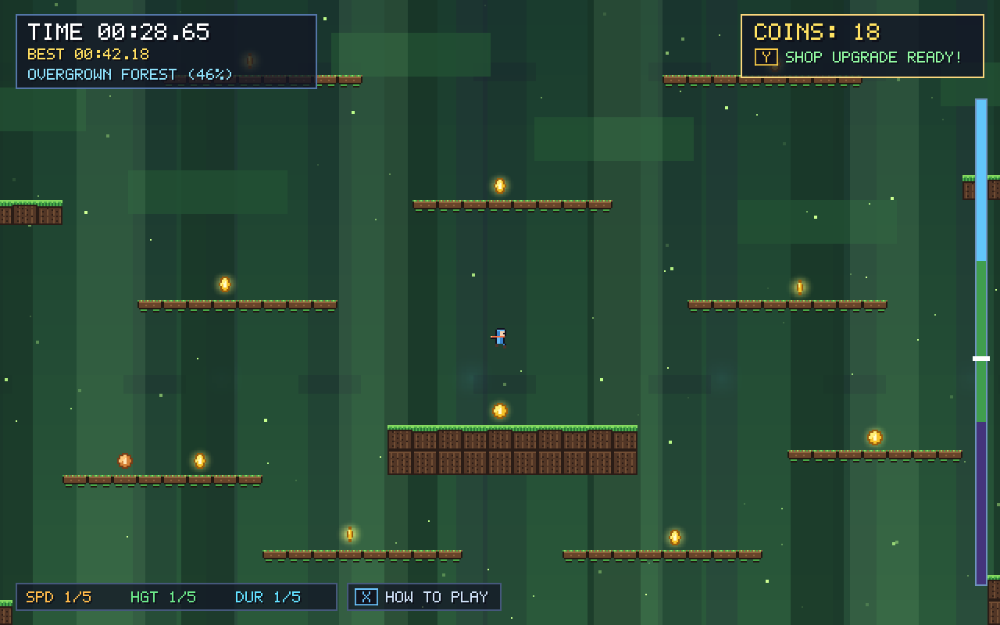
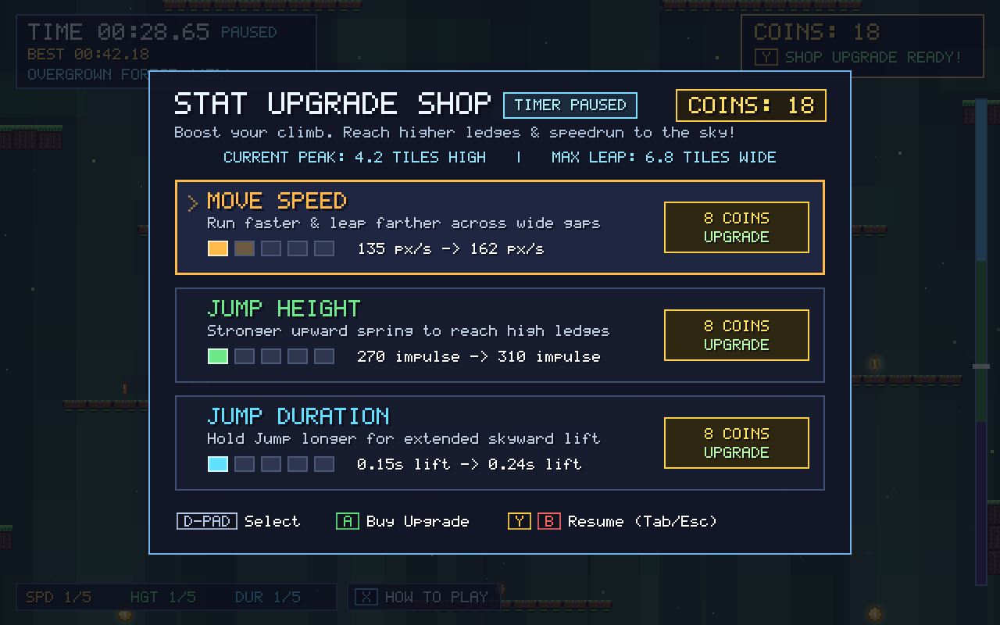
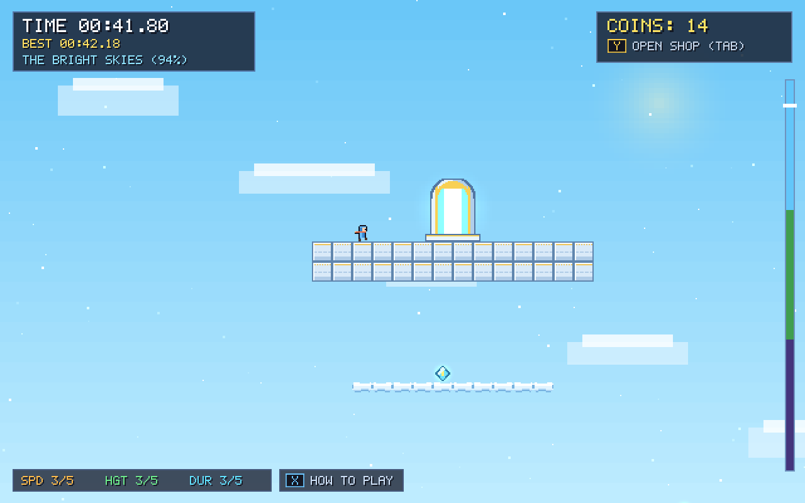

# Escape to the Skies

A Steam Deck-tailored vertical speedrun platformer built with **XNA / FNA** (`.NET 8`, `SDL3`, `FNA3D`, `FAudio`), plus a matching **HTML5 / WebAudio / Gamepad** build for **itch.io**.

## Screenshots

| Main Menu | Deep Chasm / Ancient Ruins |
| :---: | :---: |
|  |  |

| Overgrown Forest Layer | Stat Upgrade Shop (Timer Paused) |
| :---: | :---: |
|  |  |

| Bright Skies & Escape Gate Summit |
| :---: |
|  |

## Core Gameplay

- **Climb from the Deep Chasm to the Sky**: Start underground in dark, overgrown ancient stone ruins (deep blues and purples), ascend through the emerald canopy of the overgrown forest layer, and burst into the bright blues of the sunlit sky.
- **Collect Coins & Upgrade 3 Stats**: Open the shop overlay anytime (timer pauses!) to spend coins on:
  1. **Move Speed** — Run faster and leap farther across wide horizontal gaps.
  2. **Jump Height** — Increase initial jump power to scale taller ledges and shafts.
  3. **Jump Duration** — Hold Jump longer for sustained skyward lift and extended air arcs.
- **Speedrun the Summit**: Unlock higher routes, shortcuts, and rich coin caches as your stats grow. Reach the **Sky Escape Gate** at the top as fast as possible and beat your Personal Best time!

## Steam Deck & Keyboard Controls

| Action | Steam Deck (Gamepad) | Keyboard |
| :--- | :--- | :--- |
| **Move / Menu Navigate** | Left Stick or D-Pad | `A` / `D` / Arrows (`W`/`S` in menus) |
| **Jump / Hold Lift / Confirm** | `A` Button | `Space` / `Z` / `K` *(Up does NOT jump)* |
| **Drop Through Thin Ledge** | `Down + A` | `S / Down + Space` |
| **Open / Close Shop *(Timer Paused)*** | `Y` Button | `Tab` / `E` / `I` |
| **How To Play *(Timer Paused)*** | `X` Button | `H` / `F1` |
| **Pause Menu** | `Menu` (`Start`) | `Esc` / `P` |
| **Quick Restart Run** | `View` (`Back`) | `R` |
| **Toggle Fullscreen** | Main/Pause Menu | `F11` / `Alt+Enter` |

## HTML5 / itch.io Build (`web-itch/`)

A self-contained HTML5 Canvas + WebAudio + Gamepad + Touch version lives in `web-itch/` (`index.html`, `game.js`, `level-data.js`), synced directly from the C# level & stat definitions via `--export-web`:

```bash
# Re-export level & stat data from C# and package zip for itch.io
dotnet run --project EscapeToTheSkies/EscapeToTheSkies.csproj -c Release -- --export-web web-itch/level-data.js
(cd web-itch && zip -r ../escape-to-the-skies-itch.zip index.html game.js level-data.js)
```

Upload `escape-to-the-skies-itch.zip` to itch.io with **Kind of project: HTML**, check **"This file will be played in the browser"**, and set viewport size to **`1280 × 800`** (with fullscreen enabled).

## Build, Test, and Run on Steam Deck (FNA)

```bash
# Clone recursively to fetch FNA submodule
git clone --recursive https://github.com/Frankmau5/EscapeToTheSkies.git

# Build solution & run verification tests
dotnet build EscapeToTheSkies.sln -c Release
dotnet run --project EscapeToTheSkies.Tests/EscapeToTheSkies.Tests.csproj -c Release

# Publish standalone SteamOS host bundle (runs directly on SteamOS without .NET installed!)
dotnet publish EscapeToTheSkies/EscapeToTheSkies.csproj -c Release -r linux-x64 --self-contained true

# Launch the game (or click the Desktop shortcut)
./launch.sh
```
